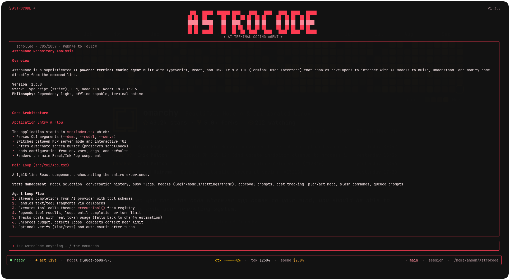

<p align="center">    
  <picture>    
    <source media="(prefers-color-scheme: dark)" srcset="assets/astrobanner-dark.png">    
    <source media="(prefers-color-scheme: light)" srcset="assets/astrobanner.png">    
        
  </picture>    
</p>


# AstroCode

<p align="center">  
  <a href="https://www.npmjs.com/package/astrocode"></a>  
  <a href="https://nodejs.org"></a>  
  <a href="https://www.npmjs.com/package/astrocode"></a>  
</p>

**A fast terminal coding agent: sub-agents, and swarm mode, on exactly two dependencies.**

AstroCode lives in your terminal. Describe a task and it reads the repo, edits  
files, runs commands, and keeps going until the job is done — streaming every  
step into the TUI so you can watch it work and interrupt it mid-thought.

It's TypeScript on [Ink](https://github.com/vadimdemedes/ink) and React, running  
on Node 18.8+ with two runtime dependencies (`ink`, `react`). No Python, no  
database, no native modules, nothing to compile.

Under the hood it's a plain agentic loop — bounded turns, 16 built-in tools,  
sub-agent delegation — pointed at any provider that speaks the OpenAI  
`/chat/completions` API: OpenAI, Anthropic, OpenRouter, or a local server like  
Ollama, LM Studio, or vLLM. No API key yet? `--demo` runs a scripted local  
provider so you can try the whole pipeline offline.

## Snapshot

<p align="center">
  
</p>

A real session: the answer streams in as rendered markdown with syntax-highlighted  
code, the indicator in the top-left tracks where you are in a long transcript, and  
the status bar carries mode, model, context %, token count, spend, branch, session,  
and cwd.

## Install

Requires Node 18.8+. Pick whichever fits your setup — all three end up with an  
`astrocode` binary on your `PATH`.

**One-liner** (macOS / Linux):

```bash
curl -fsSL https://astrocli.pages.dev/install | bash
```

The installer checks for Node 18.8+, installs from the npm registry, and falls  
back to a source build when the package isn't published yet — the same command  
works either way. Pass `--version <v>` to pin a release or `--from-source` to  
skip the registry entirely.

**npm**

```bash
npm i -g astrocode
```

**bun**

```bash
bun add -g astrocode
```

### From source

```bash
git clone https://github.com/ahsannadir/astrocode.git
cd astrocode && npm install && npm run build
node dist/index.js --demo      # no API key needed
npm run link                   # optional: `astrocode` on your PATH
```

## Connecting a model

Start the TUI, run `/login`, pick a provider, paste a key. `/model` then picks  
a model. Credentials are saved to `~/.astrocode/config.json` and reconnect  
automatically on the next launch.

The provider list covers OpenAI, Anthropic, OpenRouter, InferX, AgentRouter,  
ZenMux, and TokenRouter. For anything else that implements  
`POST /chat/completions`, choose **OpenAI Compatible**: AstroCode pulls the  
model list from `GET <baseUrl>/models`, and keyless local endpoints run fully  
live — no demo mode needed.

Once a compatible endpoint is saved, picking it again asks whether to reuse the  
saved base URL, key, and model or to reopen the wizard. Nothing is rewritten  
unless you finish the wizard.

If you'd rather skip the popup, set `ASTROCODE_API_KEY` (or `OPENAI_API_KEY`),  
`ASTROCODE_BASE_URL`, and `ASTROCODE_MODEL`. `astrocode --help` lists every  
variable AstroCode reads.


## Using it

Type what you want, in plain English. A line starting with `/` opens a menu that  
filters as you type: `↑`/`↓` to move, `Enter` to run, `Tab` to complete the  
command into the line so you can keep typing arguments, `Esc` to dismiss the  
menu without losing what you've written.

```text
You: add rate limiting to the login endpoint

❯ astrocode
```

Type `@` at the start of a word to mention a file. The picker ranks the  
workspace — the git index when the directory is a repo, otherwise a bounded  
walk — and `↑`/`↓` browse, `Tab` or `Enter` completes the path, `Esc` closes  
it without clearing the line. On submit the mentioned files are read into the  
message the model receives (up to five files, truncated at 24k characters  
each) and a `📎 attached …` line in the transcript names what went in.

The agent doesn't lock you out while it works. **Enter queues** your next prompt  
for when the current turn ends; **Esc interrupts** mid-turn and keeps your typed  
text for editing. `!cmd` runs a shell command yourself — outside the agent's  
view and outside its context.

Two modes decide what the agent may touch. Plan mode is read-only: reads,  
searches, and proposals, with writes and commands blocked at the tool layer  
rather than discouraged in the prompt. The interaction-mode row in `/settings`  
switches between plan and act. The status bar always shows which one you're in.

Shell commands are guarded the same way. In `dangerous` or `all` approval mode,  
`run_command` asks before executing: `y` runs once, `a` always allows that  
command prefix for the session, `n` or `Esc` declines. Obviously destructive  
commands are refused outright unless the model explicitly forces them.

## What's in the box

### Sessions and context

Saved sessions live in `~/.astrocode/sessions` with their model and mode, and  
`/sessions` lists them. Auto-compaction folds old 
tool batches into one-line summaries near 85% of the window, and a  
head-and-tail truncator keeps one huge `read_file` from evicting the  
conversation. A repo map — tree, file counts, scripts — builds at startup.

### Safety and reliability

Every write snapshots the original, so `/rewind` restores the tree to before  
the last turn. `run_command` refuses  
`rm -rf /`, `dd`, `mkfs`, force-push, and `reset --hard` unless explicitly  
forced, and `ASTROCODE_BUDGET` caps spend. Repeated identical tool calls are  
nudged then blocked with the first result replayed, malformed tool arguments are  
repaired instead of failing the turn, and a sub-agent that burns its budget  
still gets one final tool-less call to write its report.

### Cost and verification

Real provider usage — OpenAI `stream_options.include_usage`, Responses  
`response.completed`, or a gateway forwarding either — drives cost, the context  
meter, and budget enforcement, prompt-cache discounts included; chars÷4 is only  
the fallback. Pricing covers current OpenAI, Anthropic, Gemini, and DeepSeek.  
`ASTROCODE_VERIFY=1` runs your typecheck, lint, and tests after edits and hands  
failures back for up to two repair rounds, and `ASTROCODE_AUTOCOMMIT=1` commits  
afterwards.

### Delegation

`spawn_agent` hands work to `researcher`, `file-picker`, `code-searcher`, or  
`reviewer` — read-only, budgeted, no file edits or child agents — and a  
`workers` array runs up to five at once. `/swarm <goal>` gives each worker its  
own git worktree and branch, runs the loops in parallel, then merges the  
builders' branches back and keeps the researchers' reports; `/swarm cleanup`  
discards the lot.

### Extensibility

MCP servers in `.astrocode/mcp.json` (Claude Code's shape) surface as  
`mcp_<server>_<tool>`; `astrocode serve` points the other way, exposing  
AstroCode's tools over JSON-RPC 2.0 on stdio — read-only unless  
`ASTROCODE_SERVE_WRITES=1`. Skills are Markdown at  
`.astrocode/skills/<name>/SKILL.md`, costing one line of context until loaded.

### The interface

Streamed markdown — headings, tables, task lists, ~30 highlighted languages,  
colored diffs — wrapped in terminal cells so CJK and emoji behave. Around it: a  
status bar (mode, model, context %, tasks, spend, branch, cwd), a `todo`-driven  
task panel, and modals for `/login`, `/model`, `/settings`, and `/theme`;  
fourteen themes preview live and `Ctrl+K` copies clean text. Non-TTY stdout prints  
a banner and exits.

## Configuration

```text
astrocode [options]

  -d, --demo         Force offline demo mode (no API key needed)
  -m, --model <n>    Set the model (e.g. gpt-4o)
      --cwd <path>   Working directory (default: current)
      --serve        Run as an MCP server over stdio
  -h, --help         Show help
  -v, --version      Show version

astrocode serve [--cwd <path>]    # same as --serve
```

Anything you toggle in `/settings` — theme, verify, auto-commit, max turns,  
budget, mode — is written to `~/.astrocode/config.json` and applies immediately.  
`astrocode --help` prints the flags, the environment variables, and the full  
command list.

## Project memory

A project `ASTROCODE.md` (or `AGENTS.md`) in the repo root is injected into the  
system prompt on every launch: conventions, build commands, and anything the  
agent should never have to rediscover. Global rules go in  
`~/.astrocode/ASTROCODE.md`, and `/memory` shows what's currently loaded.

```markdown
# Project conventions

- Use pnpm, never npm.
- API routes live in src/routes; handlers return Result<T>.
- Run `npm run typecheck` before declaring anything done.
```

## Architecture

```text
src/
  index.tsx     CLI entry: flags, alternate-screen lifecycle, TUI mount
  ai/           provider clients — OpenAI chat + Responses, local demo
  tui/          Ink UI: App, layout, markdown, syntax, modals, theme
  tools/        registry.ts — the 16 tools, danger guard, plan-mode gating
  commands/     slash.ts — command table, filtering, resolution
  (harness)     sessions, memory, repomap, compact, cost, verify, undo,
                loopsensor, toolargs, tooloutput, subagent, swarm,
                worktree, mcp, skills, serve
tests/          node:test suites — offline, fake providers, temp dirs
scripts/        install.sh, pty probes, run_probes.py
```

The loop itself is small; most of the code is the harness around it. Tools are  
`{ schema, handler }` entries registered in one place, and the registry — not the  
prompt — decides what plan mode allows. `src/tui/markdown.ts` owns rendering and  
stays pure, so it can be tested without a terminal.

## Development

```bash
npm install
npm run typecheck   # tsc --noEmit
npm test            # node:test suites via tsx
npm run build       # tsc -> dist/
npm run dev         # run from source with tsx
npm run probe       # build + drive the real TUI in a pty (needs Python 3)
```

The unit tests cover the harness pieces — patch application, compaction,  
argument repair, truncation, sessions, cost math — and run offline against fake  
providers and temp dirs, so they're safe in CI.

`npm run probe` covers what unit tests can't: the keystroke → Ink → frame path.  
Each probe boots the built CLI in a pty in `--demo`, types real keys, and  
asserts on the emulated screen — popups opening and closing on `Esc`, the  
`/model` picker, the `/login` reuse prompt — then the runner stops at the first  
failure. `python3 scripts/run_probes.py --list` shows which probes gate a release  
and which are diagnostics.

## FAQ

**Does it work without an API key?**  
Yes. `--demo` runs a scripted local provider that streams text and drives the  
real tool loop. Everything except live model intelligence works.

**Where does it store data?**  
Under `~/.astrocode/` — sessions, auth config, global memory. Override with  
`ASTROCODE_CONFIG_DIR` and `ASTROCODE_SESSION_DIR`; worktree sandboxes live in  
the system temp directory.

**Can it run arbitrary shell commands?**  
Through a guarded, bounded runner. Destructive commands are refused unless  
explicitly forced, and plan mode blocks command execution entirely.

**Is my code sent anywhere?**  
Only to the model provider you configure. There's no AstroCode telemetry or  
middleman server.

## License

MIT
